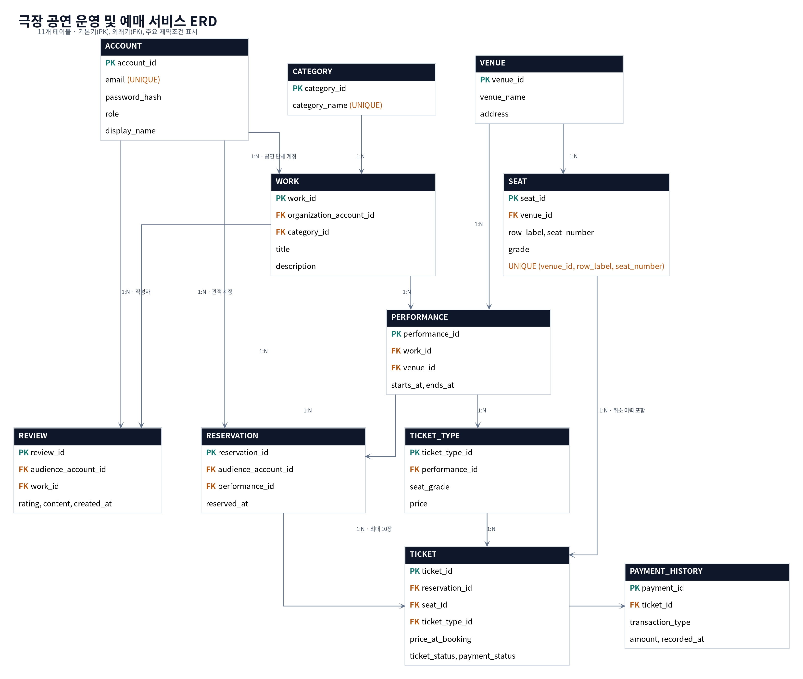

# 데이터베이스 ERD

## 설계 메모

- 관객과 공연 단체는 `ACCOUNT`에서 함께 관리하고, `role`로 구분합니다. 이메일은 `UNIQUE` 제약조건으로 중복 가입을 막습니다.
- 한 예약에는 한 공연 회차의 티켓을 최대 10장까지 포함합니다. 최대 장수 확인은 예약 처리 과정에서 합니다.
- 좌석별 취소를 지원하기 위해 결제 상태를 `TICKET`별로 관리하고, 결제와 환불 기록도 해당 티켓에 연결합니다.
- 취소한 티켓 행은 남겨 이력을 보존합니다. 해당 좌석의 재예약 가능 여부는 현재 유효한 티켓을 기준으로 확인합니다.
- 취소 가능 시간은 공연 전날 23:59까지이며, 시각 기준은 한국 시간입니다. 실제 결제 연동은 하지 않습니다.
